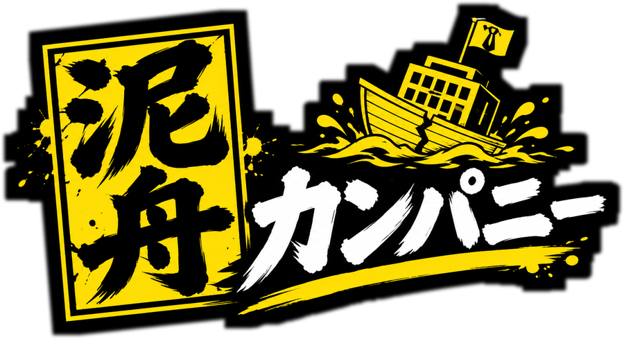
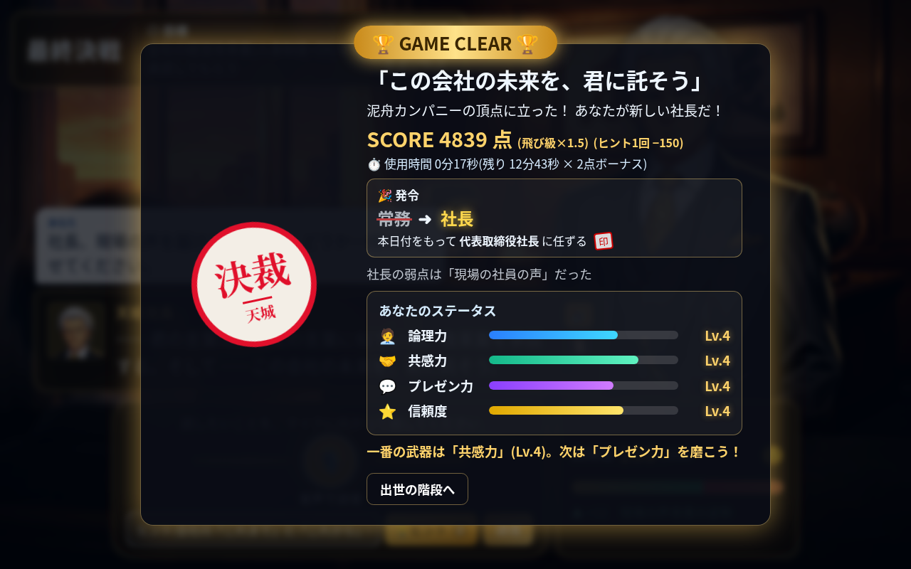

# 泥舟カンパニー — 審査員向け 1ページ要約

**一言で:** LLMが演じる一癖ある上司たちを“言葉だけ”で説得し、一般社員から社長まで出世するブラウザゲーム(音声入力・ボスの肉声つき)。

## 何が新しいか
1. **LLMの“演技力”とコードの“公平さ”を分離**: LLMは台詞と「提案された変化量」を返すだけ。ゲージ・時間・勝敗・役職はサーバが管理し、クランプ・地雷検出・インジェクション検出・勝利台詞の固定・HMAC署名トークンで、LLMをだましても勝てない
2. **資料も数字も要らない**: ボスは証拠やデータを要求せず、口頭の主張はそのまま受け止める。理屈・共感・価値観への訴え・妥協案・ユーモアで心を動かす“純粋な説得”のゲーム(要求表現はコードでも検出→再生成)
3. **毎回ちがう正解**: ボスの「隠れた弱点(本音)」は対戦ごとにランダム。部屋の様子や会話の端々から見抜く推理要素
4. **ボスが記憶し、噂する**: 対戦後にLLMが要約を保存。再戦では「またお前か。前回は〜」と前回の作戦を覚え、同じ手は効きにくい。上位ボスは下位ボスとの勝敗を噂で知っている
5. **会社が一つの世界**: 社史・社訓・派閥・因縁を持つ社内ナレッジを全ボスが共有し、同僚や社内事情に一貫して触れる
6. **表情が動く**: ボスは台詞ごとに余裕→焦り→怒り…と顔が変わる(6人×6表情の差分)
7. **声で戦う**: 音声入力(Web Speech API)+ボスごとに声と演技指示を変えたTTS(gpt-4o-mini-tts)を自動再生

## 遊び方(30秒)
- 階段: 一般社員 → 係長 → 課長 → 部長 → 常務 → 専務 → 社長。挑戦できるのは+1(昇進)か+2(飛び級)
- 勝てば相手の役職へ昇進、負ければ1段降格して地方へ左遷(辞令つき)。社長に勝てばゲームクリア
- 制限時間10〜15分、💡ヒントは1戦3回(使うと減点)
- スコア = (300×役職段 + 2×残り秒) × (飛び級1.5) − 150×ヒント

## 実プレイでの確認
- 一般社員から +2 を3回(課長 → 常務 → 社長)で実APIのままゲームクリア。社長の最後の一言(コード固定の勝利台詞):
  「……君の言葉は、祖父の言葉に似ている。改革案を承認する。そして——この会社の未来を、君に託そう。」
- 実際の対戦ログより:
  - 噂: 「……君か。鬼塚課長を説き伏せたと聞いた。営業カレンダーの件も、大和瀬常務を押し切ったとか。」(社長の第一声)
  - 再戦: 「おう、またお前か！前回はリモートの話で熱くなったな。」(課長)

## 技術
Node.js(依存ゼロ)/ 素のHTML・CSS・JS / OpenAI gpt-4.1-mini(会話・採点・要約・ヒント)/ gpt-4o-mini-tts(ボスの声)/ Web Speech API(音声入力)/ gpt-image-1.5 によるオリジナルアート。キー無しでも `mock` モードで遊べる。

※ 会社・人物はすべて架空、イラストはすべてオリジナルです。
