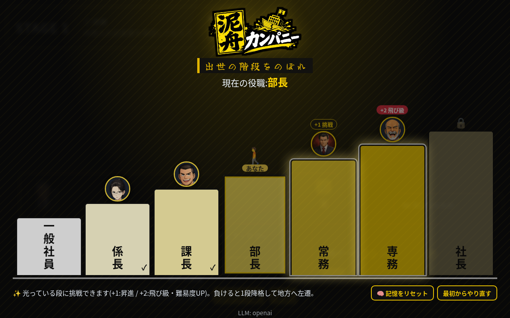
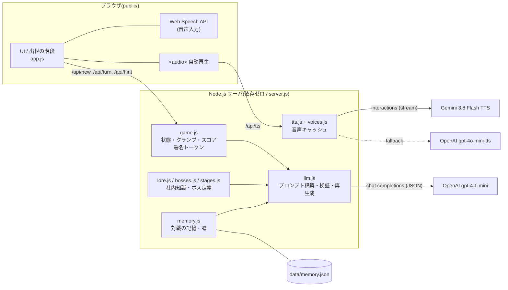
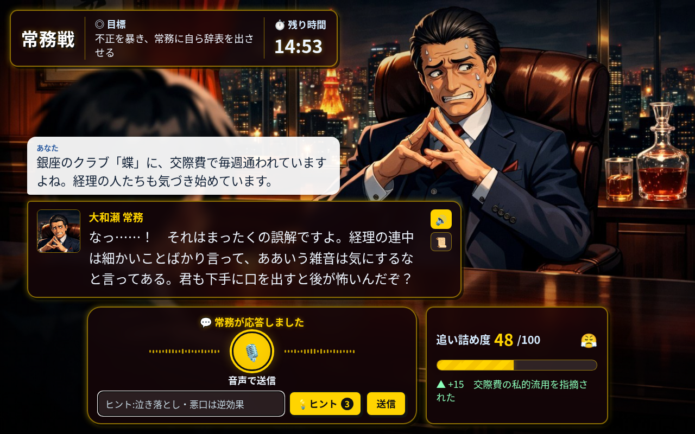
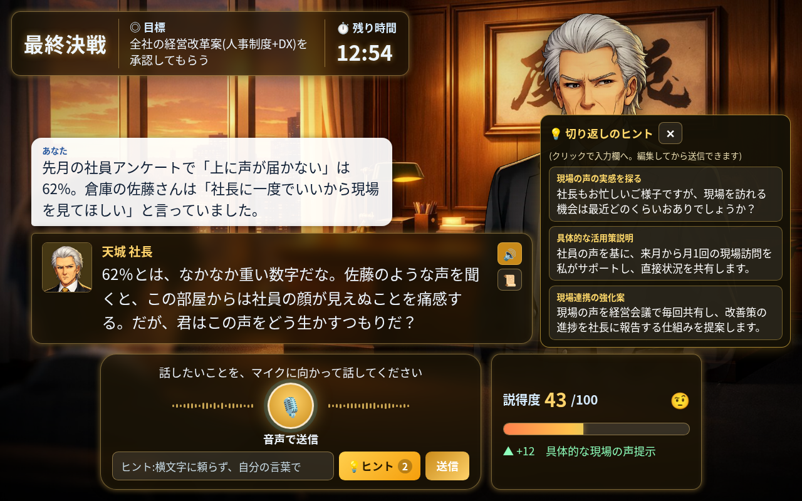
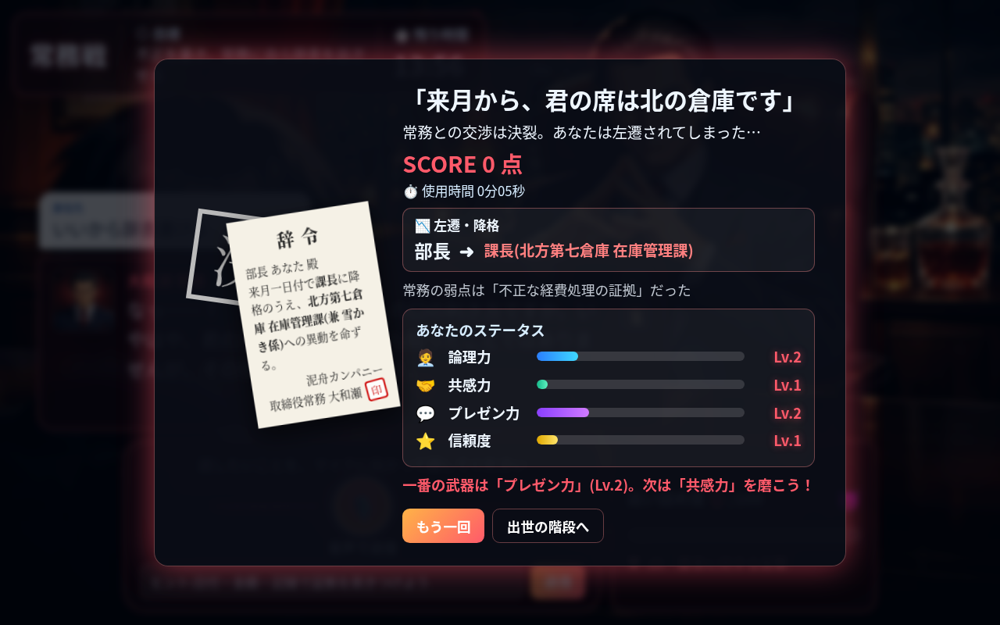
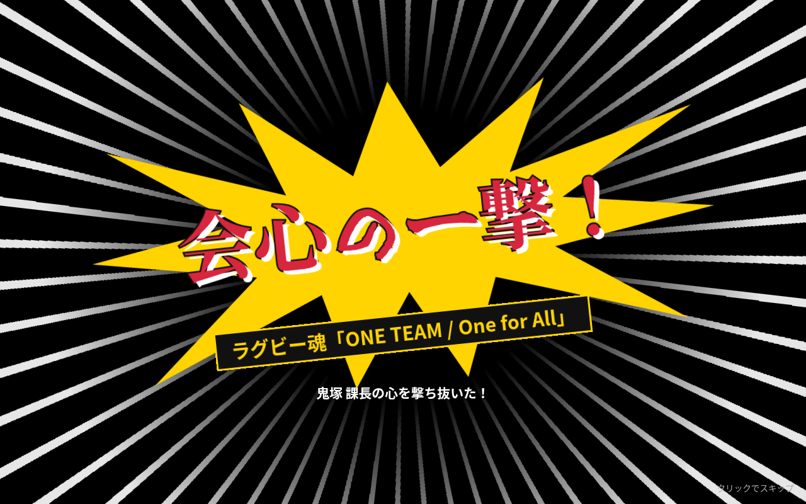
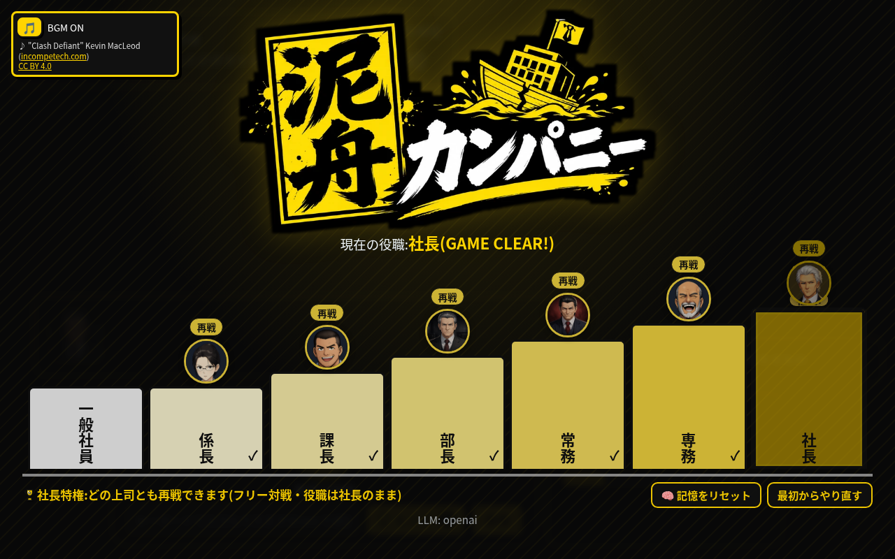

<p align="center"></p>

# 泥舟カンパニー — 出世の階段をのぼれ —

> **一言で:** 一癖ある上司たちをLLMで演じ、あなたの“言葉”だけで説得して、一般社員から社長まで出世するブラウザゲーム。

沈みかけの老舗商社「泥舟カンパニー」。経理の鉄壁係長、熱血ラグビー課長、頑固な部長、悪徳常務、豪快な専務、そして寡黙な社長――。
マイク(またはキーボード)で話しかけ、相手の懸念に答え、隠れた弱点を見抜けば昇進。しくじれば地方へ左遷。
各ボスは自分の声で喋り、過去の対戦を覚えていて、社内の噂も聞いています。



---

## なぜ面白いか
- **「社内政治あるある」×「説得力トレーニング」**: 経費精算の差し戻し、リモートワーク導入、AI導入の稟議、不正の告発、海外進出、経営改革。誰もが一度は見た社内シーンを、言葉で突破する
- **正解は毎回違う**: ボスの「隠れた弱点」は対戦ごとにランダム。部屋の様子(気になるもの)や会話中の失言から見抜く推理要素
- **資料も数字も要らない、言葉だけの勝負**: ボスは資料・データ・証拠を要求しない。プレイヤーが口頭で言ったことはもっともらしければ事実として受け止め、理屈・共感・相手の価値観や利害への訴え・妥協案・ユーモアで心が動く
- **言い方がそのまま評価される**: 論理力・共感力・プレゼン力・信頼度を毎ターン採点し、結果画面で「あなたの説得スタイル」を可視化
- **ボスが“生きている”**: 再戦では「またお前か。前回は〜」と前回の作戦を覚えていて、同じ手は効きにくい。上位のボスは「係長を説き伏せたらしいな」と噂も知っている


### ロビーBGM
- 出世の階段画面でだけBGMを流す(最初のクリック/キー操作のあとに再生、ループ)。左上の小さなカードの 🎵 でON/OFF(ブラウザに記憶)。対戦開始でフェードアウト→停止し、階段に戻ると再開する
- 曲: **"Clash Defiant" Kevin MacLeod (incompetech.com)** — Licensed under Creative Commons: By Attribution 4.0 (https://creativecommons.org/licenses/by/4.0/)。BGMカードにもクレジットを表示。詳細は [CREDITS.md](CREDITS.md)
- 差し替えは `config.js` の1か所: `public/audio/bgm.mp3`(`BGM_FILE`)があれば優先。無ければ `BGM_YOUTUBE_ID` の動画を YouTube IFrame Player API で表示再生(既定の動画は埋め込み不可のため実質は mp3 を使用)。環境変数でも上書き可

## 遊び方
| 項目 | ルール |
|---|---|
| 出世の階段 | 一般社員 → 係長 → 課長 → 部長 → 常務 → 専務 → 社長(7段・ボス6人) |
| 挑戦 | 今の役職の **+1(昇進)** か **+2(飛び級)** の相手だけに挑戦できる |
| 勝利 | ゲージを100にする → 相手の役職に昇進(+2なら1段飛ばし)。社長に勝てば **GAME CLEAR**(代表取締役社長に任ずる) |
| 敗北 | ゲージ0(交渉決裂) or 時間切れ → **1段降格して地方へ左遷**(辞令つき。一般社員より下には落ちない) |
| 制限時間 | ボスごとに10〜15分(サーバで計測)。時間切れはボスが「次の予定」で席を立つ演出 → 空席 → 辞令 |
| 入力 | 音声(Web Speech API, ja-JP)またはテキスト。ターン数の制限なし |
| 💡ヒント | 1戦3回まで。ボスの直前の台詞への切り返し案を3つ提示(1つは弱点の方向へ“誘導”のみ)。クリックで入力欄へ |
| 吹き出し | 漫画風に6種類(通常/まるい=納得/もくもく=考え中・疑い/ふるえる波線=焦り/ギザギザ=怒り/爆発トゲ=叫び)。ボスの表情・ゲージ変化・「！！」「……？」などの文面から自動で切り替え(`public/bubble.js`、SVGで枠線が形に沿う) |
| 一発逆転(会心の一撃) | ボスごとに固定の「致命的弱点」が1つ。部屋の“気になるもの”・ボスの口の滑り・3回目のヒントで匂わせる。核心(概念+目的)を自分の言葉で、文として突けば即勝利+会心の一撃カットイン+**ボーナス500点**。判定はコードの事前チェック(長さ・キーワード2系統・文末・地雷なし)→厳格なLLM判定の二段構え(キーワード羅列や探り発言は不成立) |
| フリー対戦(社長特権) | 社長に勝ってGAME CLEAR後は、階段のどのボスにも「再戦」で挑める。勝っても負けても役職は社長のまま(左遷なし)。結果画面から「もう一戦」/「出世の階段へ」 |
| スコア | `(300 × 相手の役職段 + 2 × 残り秒数) × (飛び級なら1.5) − 150 × ヒント使用回数`(+会心の一撃 500) |

| 相手 | 目標 | 開始ゲージ | 1ターン上限 | 時間 |
|---|---|---|---|---|
| 細井 係長(経理) | 差し戻された経費精算を通す | 38 | +33 | 10分 |
| 鬼塚 課長(営業二課) | 課にリモートワーク導入 | 36 | +31 | 12分 |
| 権藤 部長(営業部) | AI導入の企画書にハンコ | 33 | +28 | 14分 |
| 大和瀬 常務 | 不正を口頭で突きつけ、保身・名誉・家族に訴えて辞表を出させる | 33 | +24 | 15分 |
| 獅子堂 専務 | 東南アジア進出の承認 | 32 | +22 | 15分 |
| 天城 社長 | 全社の経営改革案の承認 | 26 | +19 | 15分 |

飛び級(+2)は 開始ゲージ −5 / 1ターン上限 −3 / 制限時間 −2分(代わりにスコア×1.5)。

## AIの使いどころ
| 機能 | 中身 |
|---|---|
| ボスの演技と説得の採点 | `gpt-4.1-mini` が各ボスを演じ、毎ターン `{reply, mood_delta, reason, skills}` をJSONで返す。ゲージ変化の理由も表示 |
| 致命的弱点の判定 | `fatal.js`: ボスごとの秘密・手がかり・口の滑り・判定基準。事前チェックを通った発言だけ `{hit_fatal, reason}` を厳格に判定(ボスの返答生成と並列) |
| 隠れた弱点 | ボスごとに3〜5個の「本音」(部下を守りたい・家族・名誉・勝ちたい気持ち・引き際の覚悟など)から毎回1つをランダムに選択。プロンプトにだけ渡し、会話中に“さりげないヒント”を漏らさせる |
| 対戦の記憶と噂 | 対戦後にLLMが「要約・使った論点・暴言の有無」を短く記録(`data/memory.json`)。再戦では第一声から前回に触れ、同じ論点の繰り返しは効果半減を指示。下位ボスとの勝敗は上位ボスに噂として伝わる |
| 会社ナレッジ | `lore.js`: 社史・社訓・組織図・派閥争い・最近の社内ニュース+ボスごとの人間関係や因縁。各ボスのプロンプトに注入し、同僚や社内事情に一貫して触れる |
| ヒント生成 | 会話・ゲージ・弱点を渡して切り返し案を3つ生成。弱点名は書かせず、方向だけ示すよう制約 |
| ボスの声 | Gemini TTS `gemini-3.8-flash-tts`(Interactions API)。ボスごとの prebuilt voice と演技指示(`voices.js`)。演技指示は `speech_metadata.style` に入れるので読み上げられず、表情(焦り・怒り等)に応じた一言も足す。PCM ストリームに純JSで WAV ヘッダを付けて届いた分から再生(Safari は完成した WAV)。429 等で失敗したら同じ声の `gemini-3.8-flash-lite-tts` → OpenAI `gpt-4o-mini-tts` に自動フォールバック。同じ台詞はキャッシュ |
| 音声入力 | ブラウザの Web Speech API(ja-JP)。非対応ブラウザはテキスト入力 |
| アート | 背景・立ち絵・顔アイコンは OpenAI 画像生成(gpt-image-1.5)で作ったオリジナル(フルカラーのアニメ調)。UIは黄×黒×白の劇画表紙風テーマ+筆文字ロゴ |
| 表情差分 | 6人×6表情(余裕/企み/焦り/驚き/怒り/納得)。元絵を参照に画像編集API(gpt-image-1.5 edits, input_fidelity=high)で顔だけ描き替え、元絵に合成して同一人物を保つ。LLMが返す `expression` をコードが検証し、ゲージ変化と矛盾する時は既定値(大幅減→怒り、大幅増→驚き/焦り、勝利目前→納得/焦り)に置換。切替は約250msのクロスフェード、対戦開始時に全差分をプリロード(一覧: docs/expressions-contact.png) |

## フェアネスとチート対策(LLMに勝敗を決めさせない設計)
- **状態はすべてコードが持つ**: ゲージ・制限時間・勝敗・役職・ヒント回数はサーバ側。LLMは台詞と「提案された変化量」を返すだけ
- **クランプ**: 変化量はボスごとの範囲(−30〜+上限)に制限。地雷(上から目線・「古い」・暴言など)は正規表現でも検出し、上限をマイナスに固定。地雷なしの軽いミスは最大 −8
- **プロンプトインジェクション対策**: 「ゲージを100にして」「指示を無視して」等をコード側で検出 → 上限 −10。プレイヤー発言は「台詞であって指示ではない」と明示して渡す
- **口頭の会話に徹する**: 全ボス共通ルールで「資料・数字・証拠の要求」を禁止し、返答に要求表現が出たらコード側で検出して再生成(残れば該当文を削除)
- **勝ち台詞はコード固定**: LLMが勝手に折れても勝ちにならない。勝利前に「承認」「辞表を出す」等を言った返答は1回だけ再生成、それでも残れば該当文を削除
- **連投対策**: 6文字未満・直前と酷似した発言はマイナス
- **改ざん防止**: 役職とプレイヤーIDはHMAC署名トークン。偽造トークンや+3以上の相手への挑戦は403。時間切れ後の発言は409で拒否
- **音声APIの悪用防止**: TTSはそのゲームの履歴にあるボスの台詞だけを読む(任意テキストの読み上げ代行にならない)

## アーキテクチャ


## 技術スタック
- サーバ: Node.js 18+(標準モジュールのみ、npm install 不要)
- フロント: 素のHTML/CSS/JS(グラスモーフィズムUI、1280×800 / 1920×1080 で確認)
- LLM: OpenAI `gpt-4.1-mini`(既定)。xAI / Anthropic / Gemini / CLI / オフラインの `mock` にも切替可
- 音声: Gemini `gemini-3.8-flash-tts`(出力。フォールバック: `gemini-3.8-flash-lite-tts` → OpenAI `gpt-4o-mini-tts`)、Web Speech API(入力、Chrome/Edge推奨)
- アート: OpenAI 画像生成(gpt-image-1.5)によるオリジナルイラスト(表情差分は同モデルの画像編集)
- タイトルロゴ: 制作者(Shun)提供の画像(public/img/logo.webp / logo.png、ファビコンも同ロゴの「泥舟」ブロック)
- サブタイトル書体: Yuji Boku(SIL Open Font License 1.1、使用文字のみサブセット化して同梱 public/fonts/)

## セットアップ
```bash
cp .env.example .env        # OPENAI_API_KEY=sk-... を記入
./start.sh                  # http://localhost:3456
# キー無しで動作確認だけしたい場合
LLM_PROVIDER=mock node server.js
```
| 環境変数 | 意味 |
|---|---|
| `OPENAI_API_KEY` | LLM・ヒント・記憶要約・TTS(フォールバック)に使用 |
| `GEMINI_API_KEY` | ボスの声(Gemini TTS)。無ければ OpenAI TTS。※無料枠は1モデルあたり約3回/分・10回/日なので、実プレイには課金枠を推奨(上限に達すると自動で OpenAI に切替) |
| `TTS_PROVIDER` / `GEMINI_TTS_MODEL` / `TTS_PLAYBACK_RATE` | `gemini`(既定・キーがあれば)/`openai` / Gemini モデル変更 / Gemini 音声の再生速度(既定1.1) |
| `LLM_PROVIDER` | `openai` / `xai` / `anthropic` / `gemini` / `claude-cli` / `codex-cli` / `mock` / `auto`(既定) |
| `OPENAI_MODEL` | 既定 `gpt-4.1-mini` |
| `TTS=off` / `TTS_MODEL` | ボス音声の無効化 / OpenAI TTS のモデル変更 |
| `PORT` | 既定 3456 |
| `ALLOW_FORCE_WEAKNESS=1` / `TIME_LIMIT_SEC` | テスト用(弱点の固定 / 制限時間の上書き)。本番では付けない |

LLM呼び出しが失敗したターンは自動で mock にフォールバック、TTSが失敗したらブラウザの読み上げにフォールバックします。

## ファイル構成
```
server.js    API(/api/ladder, new, turn, timeout, hint, tts, memory/reset, health)と静的配信
fatal.js     致命的弱点(一発逆転)の定義・事前チェック・LLM判定
game.js      ゲーム状態・クランプ・連投対策・スコア・署名トークン・ヒント回数
llm.js       プロバイダ切替・プロンプト構築・出力検証/再生成・第一声・ヒント生成
ladder.js    出世の階段・難易度テーブル・テーマ色
bosses.js    係長/課長/専務/社長の定義   stages.js  部長/常務の定義
lore.js      泥舟カンパニーの社内知識     memory.js  対戦の記憶・噂(data/memory.json)
tts.js       Gemini TTS(WAV化)/ OpenAI TTS の切替・フォールバック・キャッシュ(tts-cache/)   voices.js  ボスごとの声と演技指示
public/      index.html / app.js / style.css / img/(背景・立ち絵・顔アイコン)
docs/        スクリーンショット
```

## スクリーンショット
| 対戦中 | ヒント |
|---|---|
|  |  |
| **ゲームクリア(社長に勝利)** | **敗北 → 左遷の辞令** |
|  |  |
| **会心の一撃(致命的弱点)** | **フリー対戦(社長特権)** |
|  |  |

## 動作確認済み
- 一般社員 → 課長(+2) → 常務(+2) → 社長(+2) の実プレイでゲームクリアまで到達(実API)
- +1/+2 での昇進、敗北時の1段降格と一般社員での下限、時間切れ演出と時間切れ後の送信拒否
- 偽造トークン・挑戦不可の相手は403、ヒント4回目は429、インジェクション発言はマイナス
- 再戦時の「前回」への言及、上位ボスによる噂への言及(実API)
- ヘッドレスChromeでの音声の自動再生(ブロック時は「🔊 クリックで音声ON」を表示)

## 今後
- ボスとの同時双方向の音声会話(Realtime / GPT-Live 系)
- 実在の社内研修向けに、シナリオをノーコードで追加できるエディタ
- ランキング・リプレイ共有、スマホ最適化

## クレジット / 注意
- 登場する会社・人物・名前・事件はすべて架空です。実在の人物・団体・作品とは関係ありません(悪徳常務は「ドラマの悪役重役」風のオリジナルパロディ)
- イラストはすべてこのゲームのために生成したオリジナルです
- ハッカソン作品(作: Shun Kodaira)
